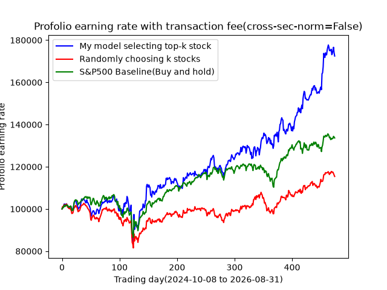
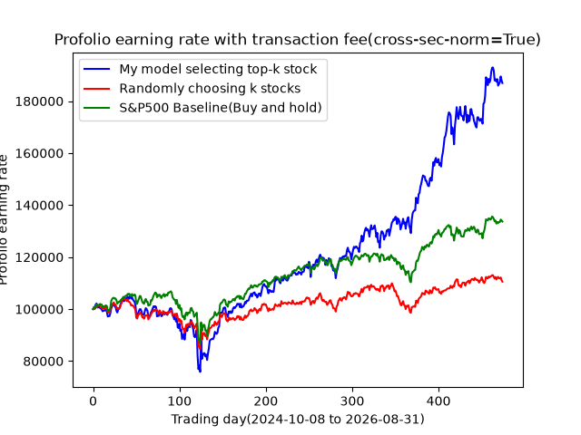

 # Stock Prediction

This project uses historical stock data and technical features to train a LightGBM model. The model ranks stocks by predicted next-day return and repurchase the top-50 stocks everday. Backtesting from September-2024 to September-2026, surpassing the Buy and hold S&P500 baseline.

## File structure

```text
run.py                   Main experiment and backtest script
requirements.txt         Python dependencies

data/
	download_data.py       Download prices and generate features
	feat_eng.py            Technical feature calculations
	load_data.py           Load and filter stock data
	preprocess.py          Normalization and train-validation split

model/
    lightGBM.py            LightGBM training function
    LSTM.py                LSTM model(you can skip this for now)          
    MLP.py                 MLP model(you can skip this for now)

profolio/
    commission.py          Trading-fee calculations
    profolio.py            Portfolio state and trading operations
    tools.py               Portfolio simulation and plot utilities

quantitative/
    tools.py               Performance metrics and report utilities

save/
    data/                  Downloaded raw data
    features_20/           Generated feature data

result/
    profolio/              Portfolio performance plots
    quantitative/          Quantitative reports
```

## Run the project

Requirements:

- Python 3.10 or newer
- Internet access for downloading data with `yfinance`
- (Optional) I encourage to use Anaconda to create seperate env

From the project root, run:

```powershell

conda activate [your_new_env]
pip install -r requirements.txt
python run.py
```

`run.py` will:

1. Download missing stock price data.
2. Generate the selected 20 features.
3. Remove stocks with incomplete data.
4. Optionally apply cross-sectional normalization with `cross_norm`.
5. Split the data into training and validation periods.
6. Train the LightGBM model.
7. Backtest the model performance in real world investment with commission fee
8. Provide Quantitative result
(the backtesting and quantitative result will be stored in result/profolio and result/quantitative)

To compare normalization settings, change this line in run.py and run the script again:

```python
cross_norm = True
```

## Results

The script saves:

- A portfolio chart in `result/profolio/`
- A quantitative report in `result/quantitative/`

The report includes annualized return, S&P 500 return, Sharpe ratio, maximum drawdown, mean Rank IC, ICIR, positive IC days, and a Sharpe ratio confidence interval. The backtest also compares the model portfolio with a random portfolio and the S&P 500.

### Portfolio performance(with a random seed)





### Quantitative results

| Metric | Without normalization | With normalization |
|---|---:|---:|
| Annualized return | 34.58% | 35.22% |
| S&P 500 annualized return | 16.67% | 16.67% |
| Maximum drawdown | -21.27% | -28.88% |
| Mean IC | 0.0094 | 0.0105 |
| Positive IC days | 51.49% | 54.71% |
| Sharpe ratio | 1.35 | 1.28 |

Normalization increased the annualized return and ranking performance slightly, but it also increased the maximum drawdown.

Full reports:

- [Without normalization](result/quantitative/summary_k=50_CN=F.txt)
- [With normalization](result/quantitative/summary_k=50_CN=T.txt)

## Future work

- Investigate why Cross-Norm causes a larger Maxdown, direction including (1)only measure the daily IC of the selected 50 stocks,(2)Record the daily return over the whole validation period, and see where the drawdown occur.
- Add risk consideration(Risk model), and bull/bear market identifier, since Cross-Norm Enabled may overperform Cross-Norm Disabled in Bull Market, and conversely underperform in bear market
- Feauture explainable and visualization, also should explain evaluation metrics
- More models

